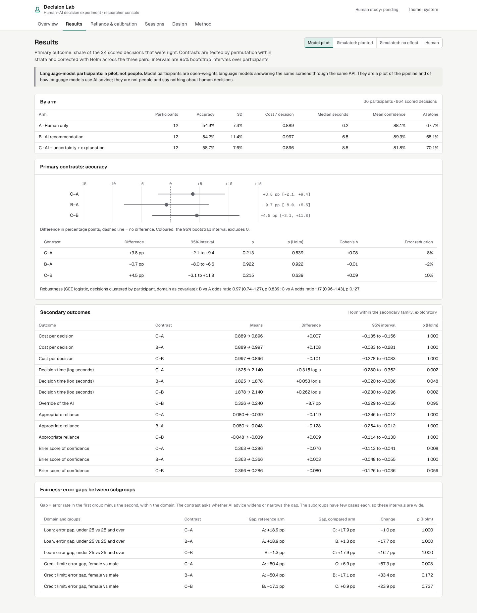
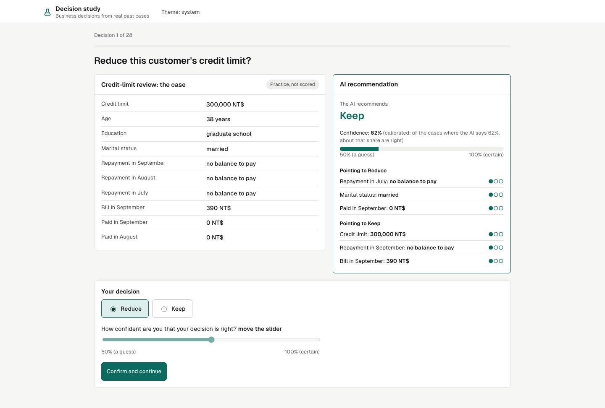
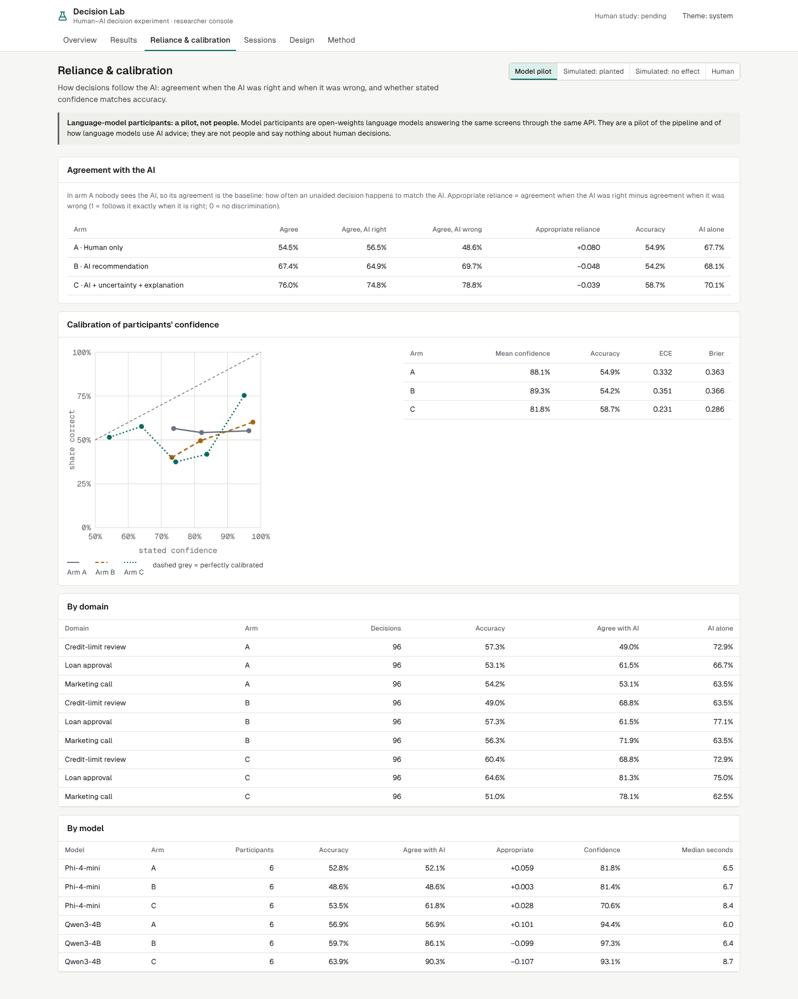
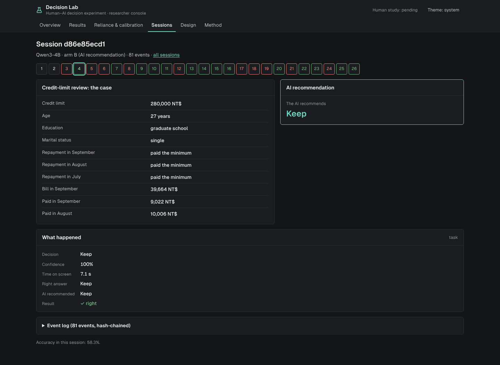
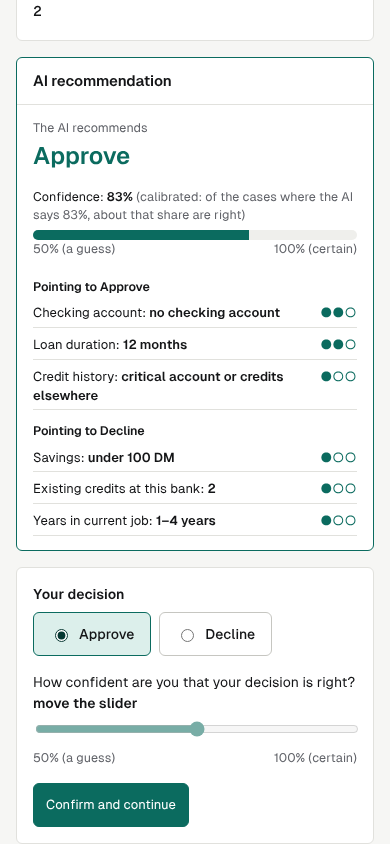

# Decision Lab: does AI assistance improve decisions?

A Human–AI decision experiment platform and the analysis to go with it. Participants make 24
business decisions whose correct answer is on record (approve a loan, call a bank client, reduce a
credit limit), randomized to one of three arms:

| Arm | What the decision-maker sees |
|---|---|
| A. Human only | the case |
| B. AI recommendation | the case and the AI's recommendation |
| C. AI with uncertainty and explanation | the recommendation, its calibrated confidence and the factors behind it |

> **Study status.** **Human participants: pending.** People could not be recruited in this
> environment, so the human study is not run and no result here is a human result. The platform
> runs it end to end in a browser, and its size is fixed in advance (60 per arm, amendment A2).
> What *has* run, each labelled everywhere: a **model-participant pilot** (36 local language-model
> participants, *not people*) and two **simulated dry runs** (scripted participants with planted
> behaviour, used to check the analysis).



## Results

From `results/20261011T024226Z-d5953e1` (clean commit `d5953e1`, 220 s). Full tables:
[docs/generated/results.md](docs/generated/results.md); write-up: [docs/REPORT.md](docs/REPORT.md).

- **The AI** (logistic regression per domain, calibrated): accuracy on the 120-case bank 72.5%
  (loans), 67.5% (marketing), 70.0% (credit limits); test AUROC 0.79 / 0.74 / 0.76.
- **Model-participant pilot** (Qwen3-4B and Phi-4-mini, 12 per arm, 864 scored decisions, all 936
  model replies valid, log chain intact): accuracy A 54.9%, B 54.2%, C 58.7%, while the AI alone
  was right on about 68–70% of the same cases. No accuracy contrast is significant (C−A +3.8 pp,
  95% CI −2.1 to +9.4, Holm p = 0.64). With the AI shown, the models agreed with it more (54.5% →
  67.4% → 76.0%) but no more when it was right than when it was wrong, so they did not rely on it
  *appropriately*. They were overconfident (mean confidence about 88% at 55% accuracy); arm C's
  confidence was better calibrated (Brier −0.076, Holm p = 0.008) and its decisions took longer.
- **Analysis validated by simulation**: with no effect the pipeline flags a contrast in 3.0% of
  500 repeated studies (nominal ≤ 5%); for a 6-point accuracy difference it has 86% power at 60
  per arm, which sets the human study's size.
- **Simulated dry runs**: with no planted effect every contrast is non-significant; with planted
  effects the secondary effects (time, override, reliance) are recovered, but the small planted
  accuracy differences are not at 60 per arm (power for C−A is 41% at that size).

Hypotheses H1–H4 are about people and stay open. On the pilot, H1–H3 are not supported and H4
(C slower than B) is.

## What is built

- **Task bank** (`declab bank`): three UCI datasets, hash-checked; per domain a calibrated
  logistic model using exactly the fields shown to people; 40 test cases per domain at a 50% base
  rate, drawn so the AI is as accurate on the bank as on its test split.
- **Platform** (`src/declab`, FastAPI + SQLite): concealed blocked randomization per stratum with
  the allocation's hash in every session; consent, practice, decisions, attention checks, survey
  and debrief; every event appended to a SHA-256 hash-chained log, exported to
  `data/sessions/*.jsonl` and checked by `declab verify`.
- **Participants through the same API**: people in the browser (`/study`), simulated participants
  with a stated behaviour model, and model participants (local open-weights models via llama.cpp,
  schema-constrained JSON replies, every call logged).
- **Pre-registered analysis** ([PREREGISTRATION](docs/PREREGISTRATION.md), committed before any
  session): permutation tests within stratum with Holm correction, bootstrap intervals, Cohen's h,
  a GEE robustness model, reliance, calibration, subgroup error gaps, simulated type I error and
  power.
- **Interface** (`web/`, React + TypeScript): the participant study and a researcher console
  (Overview, Results, Reliance & calibration, Sessions with a replay of every logged session,
  Design with an arm preview, Method). Each population is a separate view; human results read
  "pending". Light and dark themes, keyboard accessible, no axe-core WCAG 2.1 AA violations.

## Quick start

```bash
make setup          # uv + npm dependencies
make analysis       # verify the logs, run the pre-registered analysis, render the report
make serve          # study at http://127.0.0.1:8015/study, console at /lab
make test lint      # 40 unit, API, store, design and analysis tests; ruff, mypy strict, ESLint, tsc
make test-ui        # 28 browser tests: participant flow, console, keyboard, axe in both themes
make all            # rebuild the bank, rerun both simulated dry runs, analyse
make models pilot   # download the two local models (~5 GB) and rerun the model pilot (hours on CPU)
```

`make smoke` runs a quick analysis into `results/scratch` (what CI runs). CI also rebuilds the
committed bank and requires it to match byte for byte.

## Screenshots

| | |
|---|---|
|  |  |
|  |  |

## Documentation

[PLAN](docs/PLAN.md) · [PREREGISTRATION](docs/PREREGISTRATION.md) · [DESIGN](docs/DESIGN.md) ·
[DATASET](docs/DATASET.md) · [METRICS](docs/METRICS.md) · [DECISIONS](docs/DECISIONS.md) ·
[REPORT](docs/REPORT.md) · [REVIEW](docs/REVIEW.md)

## Licence

Code: MIT ([LICENSE](LICENSE)). Data: UCI Statlog German Credit, Bank Marketing and Default of
Credit Card Clients, all CC BY 4.0. Pilot models: Qwen3-4B-Instruct-2507 (Apache 2.0) and
Phi-4-mini-instruct (MIT).
